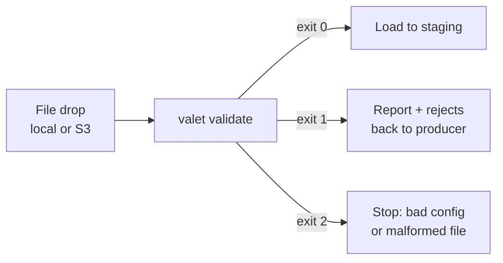
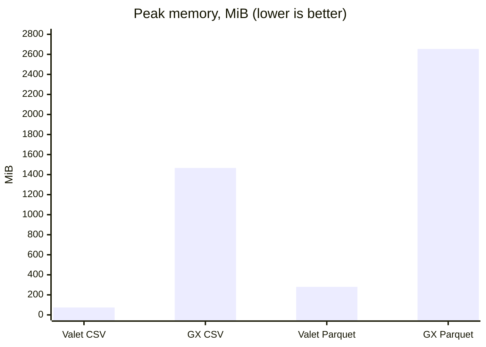
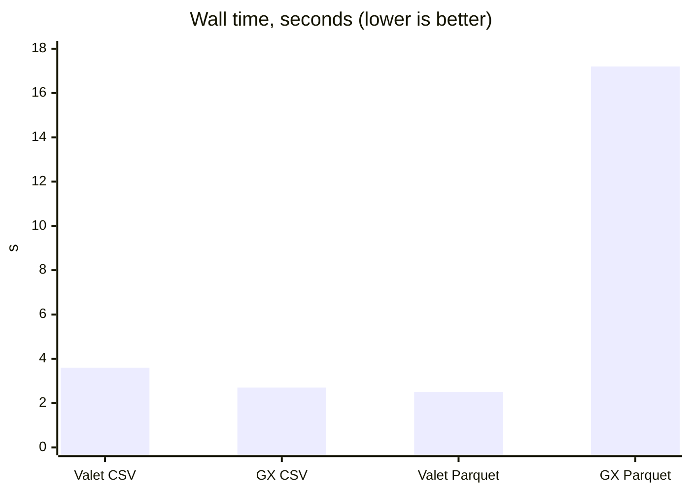

# valet

A validation gate for data files before they reach your warehouse. Valet checks
CSV, Parquet, JSON and NDJSON against a YAML or JSON pipeline; its exit code
decides whether the file moves on.



## At a glance

| | |
|---|---|
| Inputs | CSV, Parquet, JSON, NDJSON — local files or S3-compatible storage |
| Checks | Schema, nulls, ranges, allowed values, patterns, uniqueness, references, column comparisons, dataset metrics |
| Outputs | JSON report and exit code; optional pass/warn/error rows, issues, rejects and a manifest |
| Memory | Fixed managed budget (default 512 MiB), independent of file size |
| Exactness | Integers and decimals compared exactly, never through floats |
| Runtime | One executable — no Python, no service |

| Exit | Meaning |
|---|---|
| `0` | Passed (warnings allowed) |
| `1` | Error-level checks failed |
| `2` | Bad configuration, malformed input or I/O failure — with a message naming the file, line and fix |

## Performance

10M rows, 4 checks, against GX Core + pandas.

| | Valet, 1 worker | Valet, 4 workers | GX Core + pandas |
|---|---:|---:|---:|
| CSV (251 MiB) time | 5.4 s | 3.6 s | **2.7 s** |
| CSV peak memory | **53 MiB** | 74 MiB | 1,467 MiB |
| Parquet (93 MiB) time | 3.0 s | **2.5 s** | 17.2 s |
| Parquet peak memory | **112 MiB** | 280 MiB | 2,654 MiB |





Charts use Valet with 4 workers. Medians of three fresh processes on an Intel
Core Ultra X7 358H; both tools reported the same failure counts.
[Method](https://richardrh.github.io/valet/guides/performance/#comparison-with-gx-core) ·
[reproduce](benchmarks/competitors/run.py).

## Compared

| | Valet | [GX Core](https://docs.greatexpectations.io/docs/core/introduction/try_gx/) | [Soda Core](https://github.com/sodadata/soda-core) |
|---|---|---|---|
| Best fit | Files before loading | Python, DataFrame and Spark workflows | Tables already in a data source |
| Reads the data | Valet | pandas, Spark or a database | The data source's SQL engine |
| Unparseable value | Row fails, cell counted, record kept as a reject | Range check errors instead of counting | Handled by the loader |
| Malformed row | Exit `2` with file and line, or reject with `on_malformed: reject` | `read_csv` raises | Handled by the loader |
| Checks written in | YAML or JSON | Python | YAML |
| Python required | **No** | Yes | Yes |

| Linux amd64 | Valet | GX Core + pandas |
|---|---:|---:|
| Download | **12.8 MiB** | 76.4 MiB + Python |
| Installed | **42.6 MiB** | 324.7 MiB incl. Python |
| Python packages | **0** | 36 |

## Quick start

```sh
go install github.com/richardrh/valet/cmd/valet@latest   # or download a release
```

```yaml
# pipeline.yml
input:
  type: csv
  schema:
    columns:
      id:     {type: int64, nullable: false}
      amount: {type: decimal, precision: 18, scale: 2}
      status: {type: str}
rules:
  - code: AMOUNT_RANGE
    level: error
    column: amount
    checks: [{type: valid_range, min: 0, max: 10000}]
  - code: STATUS_KNOWN
    level: warn
    column: status
    checks: [{type: valid_values, values: [OPEN, PAID, CANCELLED]}]
```

```sh
valet validate -p pipeline.yml -i orders.csv          # JSON report on stdout
valet plan -p pipeline.yml -i orders.csv --format pipeline   # generate input.schema
```

[Docs](https://richardrh.github.io/valet/) ·
[Releases](https://github.com/richardrh/valet/releases) ·
[JSON Schema](https://richardrh.github.io/valet/schema/v1/pipeline.schema.json) ·
[llms-full.txt](https://richardrh.github.io/valet/llms-full.txt) ·
[MIT License](LICENSE)
