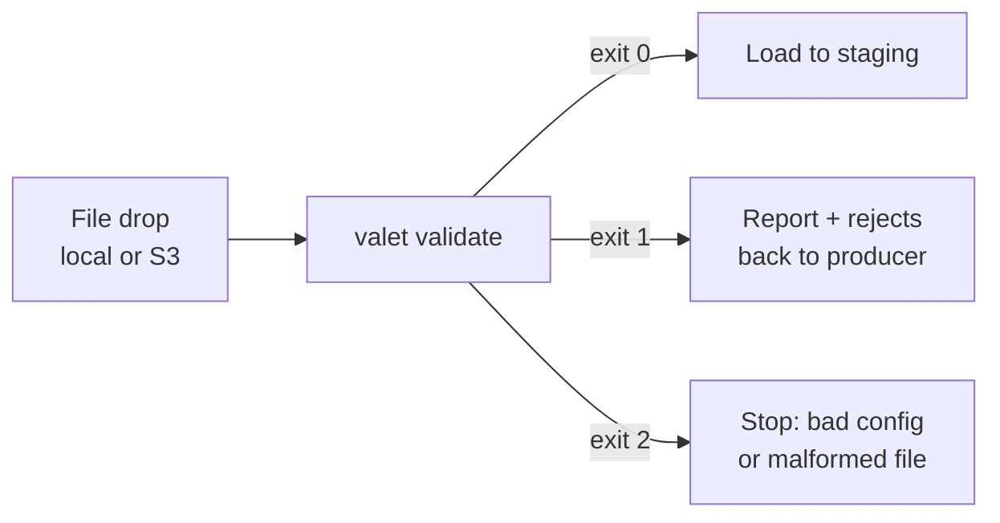

<div align="center">


# Valet

**Validate data files before they reach your warehouse.**

[](https://github.com/richardrh/valet/actions/workflows/go.yml)
[](https://github.com/richardrh/valet/releases)
[](go.mod)
[](LICENSE)

[Documentation](https://richardrh.github.io/valet/) ·
[Install](#install) ·
[Quick start](#quick-start) ·
[Rules reference](https://richardrh.github.io/valet/rules/) ·
[Releases](https://github.com/richardrh/valet/releases)

</div>

---

Valet checks CSV, Parquet, JSON and NDJSON files against rules written in YAML
or JSON. The files can be local or in S3-compatible storage. It ships as a
single Go binary, uses a fixed memory budget whatever the file size, and gives
you a JSON report and an exit code your pipeline can act on.

- **No code in the config.** Rules are declarative YAML or JSON. Nothing runs on
  your servers except Valet itself.
- **Bounded memory.** Managed memory stays within a budget, 512 MiB by default.
  Valet fails with an explicit error instead of spilling to disk.
- **Exact numbers.** Integers and decimals are compared exactly, never through
  floats.
- **One executable.** No Python, no service and no runtime to install.
- **Auditable output.** Optional pass, warn and error rows, issue lists and
  rejects, plus a manifest with a SHA-256 for every artifact.

## How it fits



| | |
|---|---|
| **Inputs** | CSV, Parquet, JSON, NDJSON, from local files or S3-compatible storage |
| **Checks** | Schema, nulls, ranges, allowed values, patterns, uniqueness, references, column comparisons, dataset metrics |
| **Outputs** | A JSON report and an exit code; optionally row buckets, issues, rejects and a manifest |

| Exit code | Meaning |
|---|---|
| `0` | Passed; warnings are allowed |
| `1` | At least one error-level check failed |
| `2` | Bad configuration, malformed input or an I/O failure. The message names the file, the line and the fix |

## Install

Download a prebuilt binary for Linux, macOS or Windows from
[Releases](https://github.com/richardrh/valet/releases).

Or build it with Go (the version in [`go.mod`](go.mod) or newer):

```sh
go install github.com/richardrh/valet/cmd/valet@latest
```

Binaries from `go install` report `dev` for `--version`; release binaries carry
their version. See the
[installation guide](https://richardrh.github.io/valet/getting-started/installation/)
for pinning versions and setting `PATH`.

## Quick start

```yaml
# pipeline.yml
input:
  type: csv
  schema:
    columns:
      id:     {type: int64, nullable: false}
      amount: {type: decimal, precision: 18, scale: 2}
      status: {type: str}
rules:
  - code: AMOUNT_RANGE
    level: error
    column: amount
    checks:
      valid_range: {min: 0, max: 10000}
  - code: STATUS_KNOWN
    level: warn
    column: status
    checks:
      not_null: true
      valid_values: [OPEN, PAID, CANCELLED]
```

```sh
valet validate -p pipeline.yml -i orders.csv                 # JSON report on stdout
valet validate -p pipeline.yml -i orders.csv -o results/     # also write row buckets, issues and a manifest
valet plan -p pipeline.yml -i orders.csv --format pipeline   # generate input.schema from the data
```

Continue with the [quick start guide](https://richardrh.github.io/valet/getting-started/quickstart/)
or [run Valet in CI](https://richardrh.github.io/valet/guides/ci/).

## Performance

10 million rows with 4 checks, compared with GX Core + pandas.

| | Valet, 1 worker | Valet, 4 workers | GX Core + pandas |
|---|---:|---:|---:|
| CSV (251 MiB), time | 5.4 s | 3.6 s | **2.7 s** |
| CSV, peak memory | **53 MiB** | 74 MiB | 1,467 MiB |
| Parquet (93 MiB), time | 3.0 s | **2.5 s** | 17.2 s |
| Parquet, peak memory | **112 MiB** | 280 MiB | 2,654 MiB |

Each figure is the median of three fresh processes on an Intel Core Ultra X7
358H, and both tools reported the same failure counts.
[Method](https://richardrh.github.io/valet/guides/performance/#comparison-with-gx-core) ·
[Reproduce](benchmarks/competitors/run.py)

## Comparison

| | Valet | [GX Core](https://docs.greatexpectations.io/docs/core/introduction/try_gx/) | [Soda Core](https://github.com/sodadata/soda-core) |
|---|---|---|---|
| Best fit | Files before loading | Python, DataFrame and Spark workflows | Tables already in a data source |
| Reads the data | Valet | pandas, Spark or a database | The data source's SQL engine |
| Unparseable value | Row fails, the cell is counted and the record kept as a reject | Range check errors instead of counting | Handled by the loader |
| Malformed row | Exit `2` with file and line, or kept as a reject with `on_malformed: reject` | `read_csv` raises | Handled by the loader |
| Checks written in | YAML or JSON | Python | YAML |
| Python required | **No** | Yes | Yes |

| Linux amd64 | Valet | GX Core + pandas |
|---|---:|---:|
| Download | **12.8 MiB** | 76.4 MiB + Python |
| Installed | **42.6 MiB** | 324.7 MiB including Python |
| Python packages | **0** | 36 |

## Documentation

| | |
|---|---|
| [Concepts](https://richardrh.github.io/valet/concepts/) | Pipelines, rules, results and the execution model |
| [Rules](https://richardrh.github.io/valet/rules/) | Built-in checks, parameters, null behaviour and recipes |
| [Guides](https://richardrh.github.io/valet/guides/) | Configuration, output, schema-only checks, operations, CI and performance |
| [JSON Schema](https://richardrh.github.io/valet/schema/v1/pipeline.schema.json) | Editor completion and validation for pipeline files |
| [llms-full.txt](https://richardrh.github.io/valet/llms-full.txt) | The full docs as a single file for LLM tools |

## Contributing

See [CONTRIBUTING.md](CONTRIBUTING.md) for local checks, code style and commit
conventions. Report security issues privately as described in
[SECURITY.md](SECURITY.md).

## License

[MIT](LICENSE)
