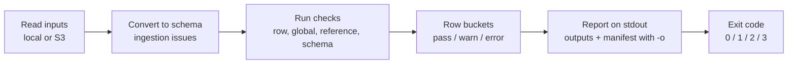

How one `valet validate` run turns input files into a report and an exit code.

| Page | Covers |
|---|---|
| [Pipelines](pipelines/) | Pipeline file, inputs and formats, input modes, declared schemas, type names |
| [Rules and checks](rules-and-checks/) | Rules, levels, check scopes, conditions, row buckets, ingestion issues, dataset rules |
| [Results](results/) | Report, exit codes, output modes, issues and rejects, manifest |
| [Execution](execution/) | Memory budget, batches and workers, passes, malformed input |
